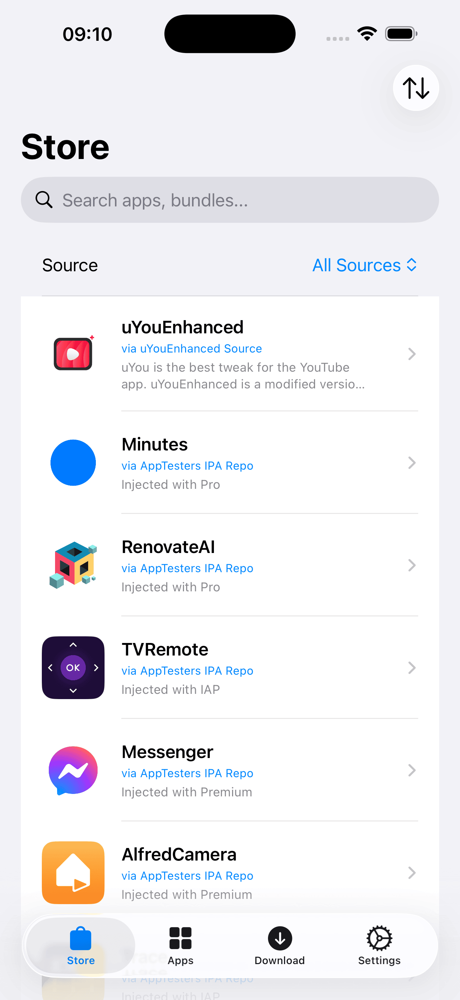
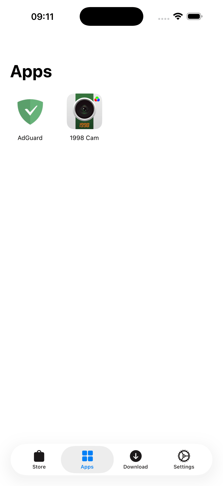
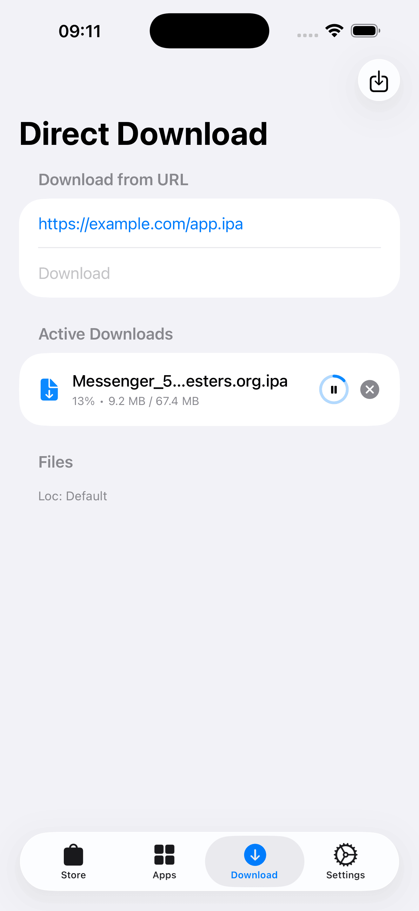
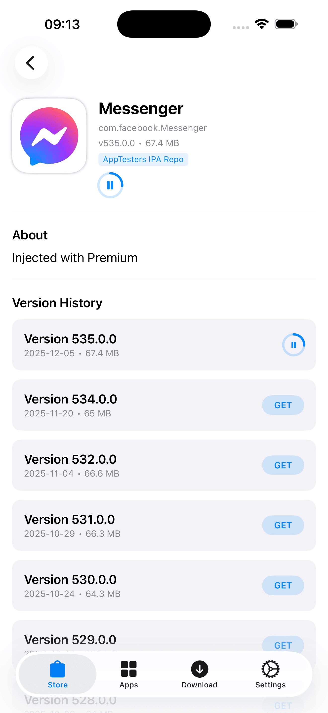

# Livebox

[简体中文](README.md) · English


**Download, update and back up your sideloaded apps — from inside LiveContainer.**

Livebox is a maintained fork of [Lolendor/LBox](https://github.com/Lolendor/LBox) (MIT, discontinued), rebuilt for one specific job: managing app sources, updates and installs while running as a guest inside LiveContainer. Everything — sources, GitHub bindings, update checks, ipa downloads, pre-update snapshots and the install hand-off — is designed around how LC actually installs apps.

> This repository ships **unsigned IPAs**. Sign them yourself (Sideloadly, AltStore, SideStore, …).

---

## Contents

- [Why](#why)
- [Features](#features)
- [Requirements](#requirements)
- [Install & first-run setup](#install--first-run-setup)
- [Multitask is required](#multitask-is-required)
- [What an update actually does](#what-an-update-actually-does)
- [Folder layout](#folder-layout)
- [Screenshots](#screenshots)
- [Troubleshooting](#troubleshooting)
- [Version history](#version-history)
- [Building it yourself](#building-it-yourself)
- [License & credits](#license--credits)

---

## Why

LiveContainer lets a non-jailbroken device run re-signed apps, but it only runs them. It does not help you find new builds, download them, keep an older copy, or put them back.

Livebox covers that gap:

- Search and download from AltStore / SideStore / any AltStore-compatible source
- Bind an installed app to a GitHub Releases repo and get version comparisons plus one-tap downloads
- Keep downloads and backups in separate folders, with a snapshot of the current build before an update
- Hand installation to LiveContainer's own installer — only that path patches the binary, so the app launches inside LC and keeps its data

Livebox is itself a guest app running inside LiveContainer, and its UI, install hand-off and folder layout follow from that.

## Features

**Store**

- Multiple sources: built-in defaults, add any AltStore-compatible repo, enable/disable and reorder
- Search, sort by name / version / release date
- Optional strict grouping: the same app from different sources is listed separately, or merged by bundle ID
- App detail page with description, version and notes

**Bound / Unbound**

- "Check sources" scans recognisable GitHub repos and proposes bindings for you to confirm
- Once bound, versions are compared against GitHub Releases (pre-release channel supported)
- Row button states: **Download → Install → Latest**, with progress/continue while downloading
- Unbound rows: **Bind** when a candidate exists, **Unknown** otherwise — tapping it opens the manual binding form
- Bulk: **Download All** (missing only) / **Update All** (serial: next one only after the previous is installed) / **No Updates**

**Downloads & backups**

- Separate folders: `ipa_downloads` and `ipa_backups`
- Download history: the newest 3 rows, scrollable inside a fixed box; retry failed ones; deleted files are marked
- "Import local IPA" in the top right: keep both or replace on name clashes
- Backups: snapshot the installed build before updating (optionally with app data); long-press an app to roll back

**Other**

- Chinese/English UI (follow system / Simplified Chinese / English), dark mode
- Logs: toggle, view and export `app.log` (installs, polling, archiving, GitHub calls and rate limiting)
- Data survives updates: installs always go through LiveContainer's installer

## Requirements

| Item | Requirement |
|---|---|
| OS | iOS / iPadOS **17.6+**, arm64 |
| LiveContainer | **3.5.0+** (multitask was introduced in 3.5.0) |
| LC install option | **Keep App Extensions** (the `LiveProcess` extension) is required for multitask |
| Classic mode | Must be **off** (classic mode never runs in multitask) |
| Signing | Sign it yourself; builds here are **unsigned** |

## Install & first-run setup

1. Sign `Livebox-x.y.z-unsigned.ipa` (Sideloadly / AltStore / SideStore) and install it — preferably inside LiveContainer.
2. Open Livebox; the first launch shows "Finish setup" → **Open Settings**.
3. Settings › Storage:
   - **LiveContainer folder** — where LC keeps its data (Livebox hands ipas to it)
   - **Storage root** — a folder you can find later (e.g. a new folder under "On My iPhone")
   - `ipa_downloads` and `ipa_backups` are created under the root for you
4. Settings › Repositories: check the built-in sources, add or enable more.
5. Go to **Store** to search, or **Apps › Unbound › Check sources** to bind GitHub repos.

## Multitask is required

This is the single most important difference from ordinary sideload managers.

In **single-task** mode LiveContainer's own process *becomes* the guest (Livebox), so the host UI does not exist and LC's guest hook rejects `livecontainer://install` — the tap appears to do nothing, or you get "restart to install".

In **multitask** mode the guest runs in the `LiveProcess` extension while the host stays alive, so LC receives the install request and shows its install dialog.

Set it once (either one):

- In LiveContainer, open **Livebox's app settings** → Multitask → **Yes** (affects Livebox only)
- Or LC **Settings › Multitask** → enable **Auto Launch in Multitask Mode** (global, every app)

Livebox checks this before every install and shows a guide (with a "copy steps" button) instead of firing a URL that cannot work. Settings shows the current state: *Multitask status · Enabled / Disabled*.

## What an update actually does

```
Tap Download        → ipa lands in ipa_downloads, button becomes Install
Tap Install         → validate the ipa → keep a copy in ipa_backups
                    → copy a throwaway file into LC's hand-off folder
                    → open livecontainer://install?url=…
LC shows "Replace / Install as new" → choose Replace to keep data
LC patches and installs → back to Livebox
Version polling sees the new build → app list reloads → button becomes Latest
```

Notes:

- **The original is never deleted**: the file in `ipa_downloads` stays; LC only removes the hand-off copy
- Hand-off copies are cleaned on return to foreground, and anything older than 10 minutes is swept at launch
- The "Replace / Install as new" dialog belongs to LC and **must be tapped by you** — Livebox cannot press it
- Bulk updates are serial: the next URL is sent only after the previous build is detected; if nothing changes within 120 s the queue pauses and asks Continue / Stop (sending early makes LC drop it)

## Folder layout

```
<storage root>
├── ipa_downloads/     downloaded and imported ipas (install source)
└── ipa_backups/       archived installers + pre-update snapshots
```

- Both folders can be installed from (long-press a row in the Downloads tab)
- Snapshots are `<uuid>/` folders, not ipas; `Name_version.ipa` files are archived installers

## Screenshots

| Store | Apps |
|---|---|
|  |  |

| Downloads | App detail |
|---|---|
|  |  |

## Troubleshooting

**Tapping Install does nothing.**
Multitask is off. Set it once as described above, restart Livebox and try again.

**The version did not change and the button still says Install.**
Livebox polls the installed build every 2 s for up to 120 s, but it only changes after you tap LC's "Replace". If you already did, wait a second or two.

**"No Payload/xxx.app/Info.plist inside the .ipa, LiveContainer cannot install it"**
That package does not match what LC expects (AltStore may still install it). Try another source or ask for a rebuild.

**GitHub checks or binding fail.**
Usually rate limiting: 60 requests/hour without a token. Enable *Skip automatic checks without a token* in Settings › Updates, add a token, or lower the frequency to hourly / every 6 hours.

**A downloaded ipa disappeared.**
Before 2.0.7 a legacy "auto extract" step archived and then deleted the source file. That path is gone: downloads now only save, never install or delete.

**Need to diagnose something?**
Settings › Logs › Export log and send `app.log`; it records installs, polling, archiving and GitHub calls (tokens and the home path are redacted).

## Version history

| Version | Highlights |
|---|---|
| 1.0 – 2.0 | Branding, bilingual UI, dark mode, data-preserving updates, GitHub bindings |
| 2.0.1 – 2.0.4 | Install flow reworked several times; 2.0.3 is broken and deprecated |
| 2.0.5 | Product renamed to `Livebox.app` / `Livebox.ipa`, store header overlap fixed |
| 2.0.6 – 2.0.8 | Stop deleting downloads; install goes back to `livecontainer://install` |
| 2.0.9 | Multitask detection + gates, install polling, three-state bulk, logs, new icon |
| 2.0.10 | Multitask status row, refresh timing, deleted-file marker, local IPA import |
| **2.0.11** | UI wording, single switch button, check frequency, pre-release archive channel, package-name archiving, error logs |

Full notes: [Releases](https://github.com/noneedtobesad7-sketch/Livebox/releases).

## Building it yourself

No Mac needed — GitHub Actions produces the unsigned build:

```
edit → push → Actions "Unsigned Build (Artifact)" → download Livebox-IPA.zip → unzip for Livebox.ipa
```

- The project uses `objectVersion = 77`, so **Xcode 26+** is required (switch `runs-on` to `macos-26` if CI complains)
- Only SPM dependency: ZIPFoundation 0.9.20
- Bundle ID: `NNSAD.Livebox`

## License & credits

- Fork of [Lolendor/LBox](https://github.com/Lolendor/LBox), MIT License
- Host runtime: [LiveContainer](https://github.com/LiveContainer/LiveContainer)
- Unzipping: [ZIPFoundation](https://github.com/weichsel/ZIPFoundation)
- Icon: drawn by the author
